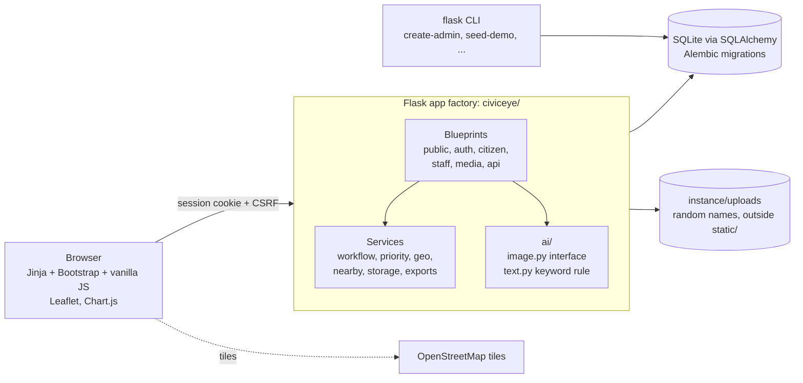
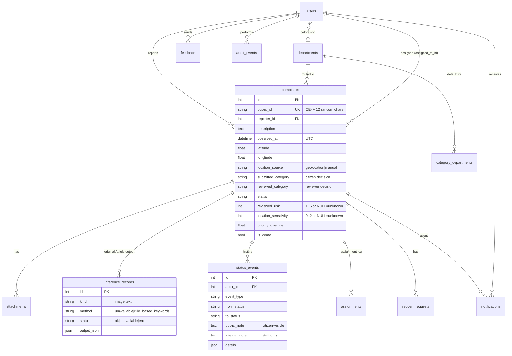

# Architecture (Phase 1)

## Components

- Web routes never call a model directly. They call `ai.image.get_image_detector()` which currently returns `UnavailableDetector`; a YOLO backend will implement the same `ImageDetector` interface (phase 2).
- Status rules live only in `services/workflow.py` (`TRANSITIONS`). Routes call `change_status()`.
- Priority is computed on read in `services/priority.py`, so age (A) is always current. No scheduled job is needed.

## ER diagram

All timestamps are stored as UTC and displayed in Asia/Kolkata (IST).
Tables planned for later phases: `duplicate_candidates`, `incident_groups`, `incident_memberships`, `traffic_uploads`, `traffic_jobs`, `traffic_configs`, `traffic_counts`.

## Status workflow

| From | Allowed next (staff) |
|---|---|
| Submitted | Under Review, Rejected |
| Under Review | Assigned, Rejected |
| Assigned | In Progress, Under Review, Rejected |
| In Progress | Resolved, Assigned |
| Resolved | none directly; Reopened only by approving a citizen reopening request |
| Rejected | none |
| Reopened | Under Review, Assigned, Rejected |

- Rejected requires a citizen-visible reason. Resolved requires a resolution note.
- Assigned requires a department to be set first.
- Rejected and Resolved are terminal for direct staff transitions.
- Citizens cannot change status. They can correct their category before review, add clarifications while open, and request reopening when resolved.

## Priority engine

`P = 0.45R + 0.25L + 0.20A + 0.10C`, every component in [0, 1]. The weights are a project design choice, not scientifically validated.

| Component | Scale | Missing value |
|---|---|---|
| R reviewed safety risk | reviewer picks 1–5, normalised `(n-1)/4` | counts 0, score marked **Provisional** |
| L location sensitivity | reviewer picks 0/1/2 (rationale required if > 0), normalised `n/2` | counts 0, **Provisional** |
| A unresolved age | `min(days / 30, 1)`; frozen at resolution time | always known |
| C corroboration | `min(distinct other reporters / 4, 1)`; same account counted once, original reporter excluded | 0 until duplicate linking (phase 2) |

Bands (configurable): High ≥ 0.70, Medium ≥ 0.40, Low otherwise. Override: staff value 0–1 with mandatory reason, logged in history. Model confidence is never an input.

## Routes

| Route | Method | Access | Purpose |
|---|---|---|---|
| `/`, `/guidance`, `/privacy` | GET | public | info, limitations, aggregate counts only |
| `/register`, `/login` | GET/POST | public | rate-limited |
| `/logout` | POST | signed in | |
| `/me/` | GET | citizen | dashboard |
| `/me/complaints/new` | GET/POST | citizen | submit complaint |
| `/me/complaints` | GET | citizen | own complaints |
| `/me/complaints/<id>` | GET | owner only (404 otherwise) | detail, history, priority |
| `/me/complaints/<id>/submitted` | GET | owner | confirmation |
| `/me/complaints/<id>/category` | POST | owner, status submitted | correct category |
| `/me/complaints/<id>/clarify` | POST | owner, open status | note and/or photo |
| `/me/complaints/<id>/reopen` | GET/POST | owner, status resolved | reopening request |
| `/me/notifications` | GET/POST | signed in | in-app notifications (own only) |
| `/me/feedback` | GET/POST | signed in | app feedback |
| `/media/<attachment_id>` | GET | owner or staff | evidence images (no-store) |
| `/api/suggest-category` | POST JSON | signed in | keyword suggestion |
| `/api/nearby?lat&lon&category` | GET | signed in | nearby reports: distance, category, status only |
| `/staff/` | GET | reviewer/admin | dashboard |
| `/staff/complaints` | GET | reviewer/admin | list + filters |
| `/staff/complaints/export.csv` | GET | reviewer/admin | CSV, no identities, formula-safe, audited |
| `/staff/complaints/<id>` | GET | reviewer/admin | review page |
| `/staff/complaints/<id>/{status,category,risk,assign,override,note}` | POST | reviewer (object-level) / admin | review actions |
| `/staff/reopen-requests`, `/staff/reopen-requests/<n>` | GET/POST | reviewer/admin | decide reopening |
| `/staff/map` | GET | reviewer/admin | exact-location map |
| `/staff/admin/{users,departments,feedback,audit}` | GET/POST | admin | administration |

Object-level rule for reviewers: they may act on a complaint that is unassigned, assigned to them, or assigned to their department. Admins may act on all.
